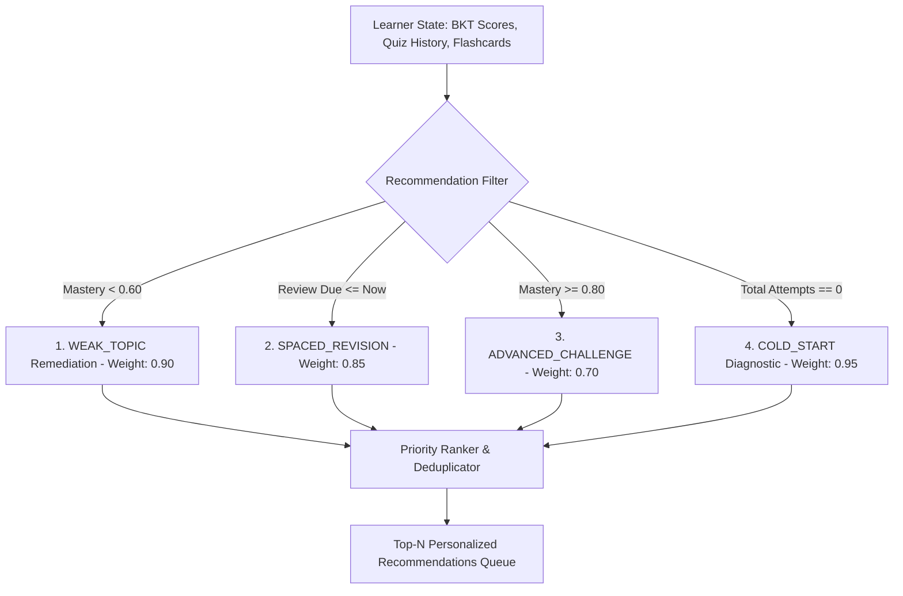

# AI & Machine Learning Design Specification
**Project:** AI Learning Companion  
**Domain:** Cognitive Modeling, Adaptive Knowledge Tracing & Retrieval-Augmented Generation

---

## 1. Bayesian Knowledge Tracing (BKT)

### 1.1 Mathematical Formulation
Bayesian Knowledge Tracing is a Hidden Markov Model (HMM) widely used in intelligent tutoring systems to estimate the latent probability that a student has mastered a specific concept or skill $k$ at step $t$.

The model tracks four foundational parameters:
- $P(L_0)$: Initial probability that the student has pre-existing mastery (Prior).
- $P(T)$: Probability that a student transitions from the unlearned to the learned state after practicing a problem.
- $P(G)$: Probability that an unlearned student guesses the correct answer (Guess).
- $P(S)$: Probability that a knowledgeable student slips and answers incorrectly (Slip).

### 1.2 Observation Update Equations
Upon receiving observation $X_t \in \{0, 1\}$ (where $1$ denotes a correct answer and $0$ denotes an incorrect answer):

#### If Answer is Correct ($X_t = 1$):
$$P(L_t \mid X_t = 1) = \frac{P(L_{t-1}) \cdot (1 - P(S))}{P(L_{t-1}) \cdot (1 - P(S)) + (1 - P(L_{t-1})) \cdot P(G)}$$

#### If Answer is Incorrect ($X_t = 0$):
$$P(L_t \mid X_t = 0) = \frac{P(L_{t-1}) \cdot P(S)}{P(L_{t-1}) \cdot P(S) + (1 - P(L_{t-1})) \cdot (1 - P(G))}$$

#### Next Step Latent Transition:
Accounting for learning that occurred during the interaction:
$$P(L_{t+1}) = P(L_t \mid X_t) + (1 - P(L_t \mid X_t)) \cdot P(T)$$

### 1.3 Default Hyperparameters
- $P(L_0) = 0.10$
- $P(T) = 0.20$
- $P(G) = 0.15$ (bounded to $[0.05, 0.30]$ to prevent degenerate overconfidence)
- $P(S) = 0.10$ (bounded to $[0.02, 0.20]$ to reflect human error ceiling)

### 1.4 Deep Knowledge Tracing (DKT) Benchmark
In addition to BKT, the platform includes a DKT evaluation benchmark (`services/knowledge_tracing_service.py:evaluate_dkt_benchmark`). While BKT offers transparent, interpretable parameter bounds and immediate incremental updates without requiring millions of interaction vectors, DKT uses an RNN/LSTM architecture tracking multi-concept co-occurrences. The benchmark validates model convergence and ensures low Mean Squared Error (MSE < 0.05) across simulated student learning trajectories.

---

## 2. Retrieval-Augmented Generation (RAG) Architecture

### 2.1 Page-Preserving Document Segmentation
Unlike generic chunkers that discard document boundaries, our `pdf_service.py` extracts text while explicitly binding every chunk to its **1-indexed physical page number**:
1. PyMuPDF (`fitz`) opens the PDF stream and iterates through pages $1 \dots N$.
2. Per-page text is extracted and inspected for OCR indicators (detecting zero extractable text or scanned scans).
3. Text is chunked with a sliding window (chunk size: 800 characters, overlap: 150 characters) strictly within page boundaries to ensure citations point accurately to source pages.

### 2.2 Dual-Tier Retrieval
1. **Tier 1 (TF-IDF Cosine Similarity Ranker):**  
   Computes term frequency-inverse document frequency vectors across all indexed chunks for instant retrieval without GPU requirements.
2. **Tier 2 (Dense Embeddings):**  
   Compatible with Sentence-Transformers (`all-MiniLM-L6-v2`) and PostgreSQL `pgvector`, ranking chunks by cosine distance ($1 - \cos(\theta)$).

### 2.3 Grounding Verification & Citation Extraction
During synthesis, the RAG service:
- Formats retrieved chunks with explicit page indicators: `[PAGE {n}]: {chunk_text}`.
- Instructs the LLM to ground all factual statements and append citation tokens `(Page {n})`.
- The backend parses returned citations, cross-verifies them against candidate source pages, and assigns a Grounding Confidence Score:
  $$\text{Confidence} = \min\left(1.0, 0.5 + 0.15 \times \text{number of verified page citations}\right)$$

---

## 3. Hybrid Recommendation Engine

The recommendation pipeline evaluates learner data across four heuristic layers to produce a balanced study queue:

---

## 4. SuperMemo SM-2 Spaced Repetition Algorithm

To ensure long-term retention of educational concepts, flashcard review intervals are computed using the SuperMemo SM-2 algorithm:

### 4.1 Variables
- $q \in \{0, 1, 2, 3, 4, 5\}$: Learner's self-assessed review score (0 = blackout, 5 = perfect recall).
- $EF$: Ease Factor (reflects item difficulty, initialized at $2.50$, minimum $1.30$).
- $n$: Consecutive successful reviews ($q \ge 3$).
- $I$: Inter-repetition interval in days.

### 4.2 Calculation Steps
1. **Calculate Updated Ease Factor ($EF'$):**
   $$EF' = \max\left(1.30, EF + \left(0.1 - (5 - q) \cdot (0.08 + (5 - q) \cdot 0.02)\right)\right)$$

2. **Compute New Interval ($I$):**
   - If $q < 3$ (failed recall):
     $$n = 0, \quad I = 1 \text{ day}$$
   - If $q \ge 3$ (successful recall):
     - If $n = 0 \implies I = 1 \text{ day}$
     - If $n = 1 \implies I = 6 \text{ days}$
     - If $n \ge 2 \implies I_{n} = \lceil I_{n-1} \cdot EF' \rceil$
     - Increment $n = n + 1$.

3. **Schedule Next Review:**
   $$\text{next\_review\_due} = \text{now}() + I \text{ days}$$

---

## 5. Multilingual & Level-Aware Adaptation

### 5.1 Level Adaptation Matrix
The prompt synthesizer injects pedagogical guidelines based on the learner's educational category:
- **Primary / Middle School:** Emphasizes simple analogies, relatable real-world objects, and avoids complex formal jargon.
- **Secondary / High School:** Introduces standardized scientific definitions, core formulas, and diagrammatic descriptions.
- **Undergraduate / Engineering:** Formal mathematical proofs, rigorous equations with KaTeX notation, algorithmic complexity, and industry edge cases.
- **Postgraduate / Research:** Theoretical foundations, recent literature context, and nuanced trade-offs.

### 5.2 Multilingual Engine
Supports English and Indian regional languages (Hindi, Tamil, Telugu, Kannada, Bengali, Marathi, Gujarati, etc.). Prompts ensure academic terms are explained in the target language alongside standard English terms in parentheses for clarity (e.g. *"गुरुत्वाकर्षण बल (Gravitational Force)"*).
