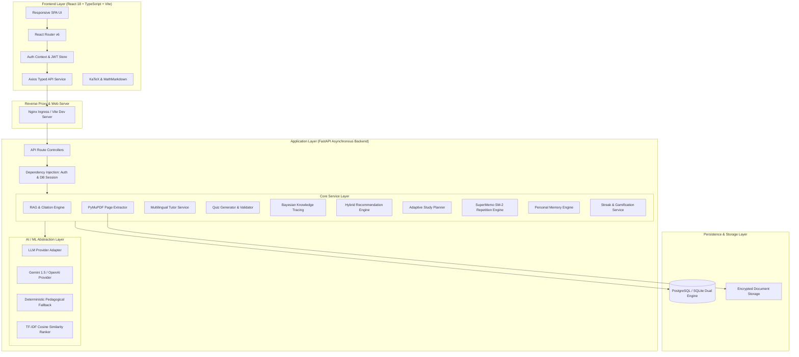
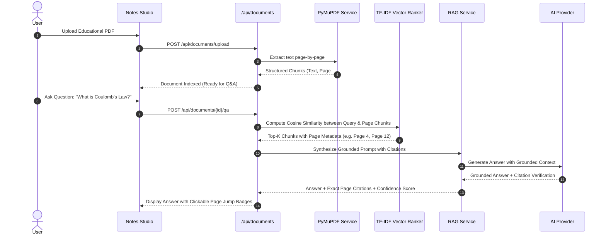

# System Architecture & Technical Design Specification
**Project:** AI Learning Companion  
**Domain:** AI/ML-Powered Multilevel Personalized Education Platform (UN SDG 4)

---

## 1. System Overview

**AI Learning Companion** is architected as a modular, decoupled full-stack system designed for scalability, zero-friction local execution, and high-performance cloud deployment. The architecture cleanly separates user presentation, application logic, persistence, and machine learning computation.



---

## 2. Frontend Architecture

### 2.1 Technology Stack & Design System
- **Framework:** React 18 with TypeScript in strict mode.
- **Build System:** Vite 5 for instant HMR and optimized production bundling.
- **Styling:** Tailwind CSS with an academic-focused aesthetic:
  - Deep Indigo primary (`indigo-600` / `indigo-700`)
  - Emerald accents for positive mastery states (`emerald-600`)
  - Slate neutrals (`slate-50` through `slate-900`) for high text legibility
- **Mathematics & Markup:** MathMarkdown component with inline `$` and block `$$` KaTeX rendering for science and mathematical formulas.
- **Visual Analytics:** Recharts for mastery distribution bar charts and cumulative progress line charts.

### 2.2 Component Hierarchy
```
frontend/src/
├── components/
│   ├── common/
│   │   ├── Badge.tsx           # Contextual status indicators
│   │   ├── Button.tsx          # Accessible interactive buttons with loading spinners
│   │   ├── Card.tsx            # Structural panels with hover states
│   │   ├── MathMarkdown.tsx    # Safe Markdown + KaTeX rendering
│   │   └── Modal.tsx           # Accessible modal dialogs with backdrop blur
│   └── layout/
│       ├── AppLayout.tsx       # Core dashboard shell with responsive navigation
│       ├── Header.tsx          # Top nav bar: user profile, streak badge, XP badge
│       └── Sidebar.tsx         # Collapsible sidebar with active route tracking
├── contexts/
│   └── AuthContext.tsx         # User authentication state, token refresh, and profile
├── pages/                      # 16 complete functional views
│   ├── LandingPage.tsx         # Value proposition, SDG 4 features, quick action
│   ├── LoginPage.tsx           # Email/password authentication
│   ├── RegisterPage.tsx        # Multi-stage onboarding questionnaire
│   ├── DashboardPage.tsx       # Daily summary, quick stats, active study plan
│   ├── NotesStudioPage.tsx     # PDF drag-and-drop upload and document library
│   ├── DocumentDetailPage.tsx  # Document viewer, RAG Q&A, exact page citations
│   ├── AITutorPage.tsx         # Multilingual conversation with depth selector
│   ├── QuizArenaPage.tsx       # Quiz generation and attempt history
│   ├── QuizTakePage.tsx        # Interactive timed quiz evaluation
│   ├── QuizResultsPage.tsx     # Instant score breakdown and explanation review
│   ├── AnalyticsPage.tsx       # BKT mastery distribution and skill breakdown
│   ├── ConceptMapPage.tsx      # SVG graphical concept prerequisite hierarchy
│   ├── StudyPlannerPage.tsx    # Daily schedule with interactive task completion
│   ├── FlashcardsPage.tsx      # SuperMemo SM-2 active recall trainer
│   ├── MemoryPreferencesPage.tsx # Personal memory inspection and deletion
│   ├── SharedKnowledgePage.tsx # Community resources and contribution pipeline
│   └── ProfileSettingsPage.tsx # Educational stage and learning preference controls
└── services/
    └── api.ts                  # Axios client with automatic Bearer token injection
```

---

## 3. Backend Architecture

### 3.1 Layered Design & Separation of Concerns
The backend adheres to a strict layered architectural pattern:
1. **API Layer (`app/api/routes/`):** Exclusively handles HTTP request serialization, Pydantic model validation, route authorization, and HTTP status codes.
2. **Dependency Layer (`app/api/deps.py`):** Provides dependency injection for database sessions (`get_db`) and JWT token decoding with user authentication (`get_current_user`).
3. **Service Layer (`app/services/`):** Contains pure, testable domain business logic independent of HTTP protocols.
4. **Integration Layer (`app/integrations/`):** Adapts external LLM providers and local fallbacks through a unified interface.
5. **Persistence Layer (`app/models/`):** SQLAlchemy ORM models with strict foreign key constraints and cascade rules.

---

## 4. End-to-End Data Pipelines

### 4.1 Grounded Document RAG Pipeline


### 4.2 Bayesian Knowledge Tracing (BKT) Updating Pipeline
When a student answers a quiz question on a specific topic $k$:
1. Fetch current prior probability of mastery $P(L_{t-1})$.
2. If student answers correctly ($X_t = 1$):
   $$P(L_t \mid X_t = 1) = \frac{P(L_{t-1}) \cdot (1 - P(S))}{P(L_{t-1}) \cdot (1 - P(S)) + (1 - P(L_{t-1})) \cdot P(G)}$$
3. If student answers incorrectly ($X_t = 0$):
   $$P(L_t \mid X_t = 0) = \frac{P(L_{t-1}) \cdot P(S)}{P(L_{t-1}) \cdot P(S) + (1 - P(L_{t-1})) \cdot (1 - P(G))}$$
4. Account for transition probability $P(T)$ to obtain posterior mastery for the next observation:
   $$P(L_{t+1}) = P(L_t \mid X_t) + (1 - P(L_t \mid X_t)) \cdot P(T)$$
5. Persist updated mastery score in `learning_progress` table and record attempt audit in `quiz_attempts`.

---

## 5. AI/ML Provider Abstraction

To ensure uninterrupted service and zero external dependency failures, the system features a provider-agnostic abstraction:

```python
class LLMProviderInterface(ABC):
    @abstractmethod
    def generate_chat_response(
        self, messages: list[dict], level: str, language: str, depth: str
    ) -> str: ...

    @abstractmethod
    def generate_grounded_answer(
        self, question: str, chunks: list[dict], level: str
    ) -> tuple[str, list[dict]]: ...

    @abstractmethod
    def generate_quiz_questions(
        self, topic: str, count: int, level: str
    ) -> list[dict]: ...
```

- **Cloud Adapter:** Supports Google Gemini API (`gemini-1.5-pro-latest`) and OpenAI-compatible API endpoints.
- **Pedagogical Fallback Engine:** A deterministic rule-based knowledge engine that formats accurate step-by-step educational explanations, KaTeX proofs, and verified MCQ questions whenever no external API keys are configured.
- **System Health Diagnostics:** Available at `GET /api/system/status`, exposing model active state, latency, and provider name.

---

## 6. Database Architecture & Dual-Mode Persistence

The application supports seamless dual operation:
- **Zero-Config Development:** SQLite with file persistence at `./learning_companion.db`.
- **Production Scale:** PostgreSQL 16 with `pgvector` extension for native vector cosine distance queries (`<=>`).
- SQLAlchemy abstracts the underlying SQL dialect, guaranteeing identical query semantics across development and production environments.

---

## 7. Security Architecture
- **Password Protection:** Cryptographic salted password hashing using `bcrypt`.
- **Stateless Authorization:** Cryptographic JSON Web Tokens (JWT) signed with HMAC-SHA256, carrying user IDs and role claims.
- **Data Isolation:** User personal memories and private uploaded documents are strictly scoped to `user_id`.
- **CORS Protection:** Configurable domain whitelisting preventing unauthorized cross-origin requests.
