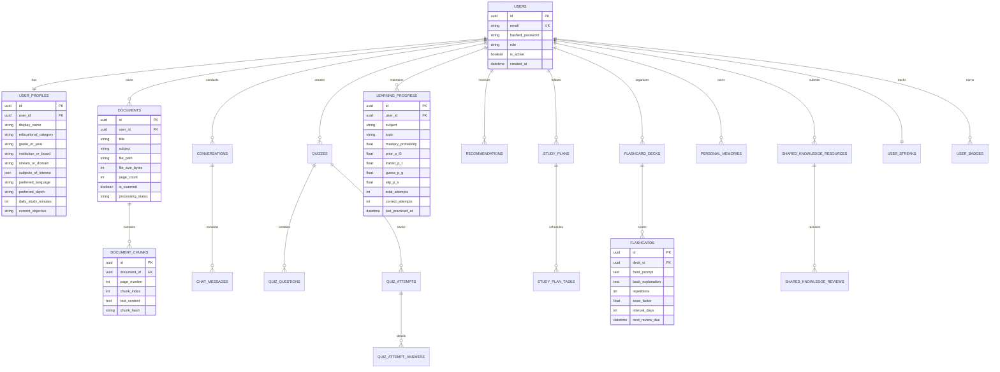

# Database Schema Specification & Data Architecture
**Project:** AI Learning Companion  
**RDBMS:** PostgreSQL (Production) / SQLite (Development) with `pgvector` Compatibility

---

## 1. Entity-Relationship Overview



---

## 2. Table Specifications & Constraints

### 2.1 Core Identity & Profiles

#### `users`
Stores credentials and security status.
- `id` (UUID, Primary Key)
- `email` (VARCHAR(255), Unique, Indexed, Not Null)
- `hashed_password` (VARCHAR(255), Not Null)
- `role` (VARCHAR(50), Default: `'STUDENT'`, Enum: `STUDENT`, `EDUCATOR`, `MODERATOR`, `ADMIN`)
- `is_active` (BOOLEAN, Default: `TRUE`)
- `created_at` (TIMESTAMP WITH TIME ZONE, Default: `CURRENT_TIMESTAMP`)
- `updated_at` (TIMESTAMP WITH TIME ZONE, Auto-updated)

#### `user_profiles`
Maintains multi-level learner adaptation settings.
- `id` (UUID, Primary Key)
- `user_id` (UUID, Foreign Key `users.id` ON DELETE CASCADE, Unique, Indexed)
- `display_name` (VARCHAR(100), Not Null)
- `educational_category` (VARCHAR(100), e.g. `'UNDERGRADUATE'`, `'SENIOR_SECONDARY'`, `'VOCATIONAL'`)
- `grade_or_year` (VARCHAR(50), e.g. `'3rd Year'`, `'Class 12'`)
- `institution_or_board` (VARCHAR(150), e.g. `'CBSE'`, `'VTU'`, `'Self-Taught'`)
- `stream_or_domain` (VARCHAR(100), e.g. `'Computer Science'`, `'Science (PCM)'`)
- `subjects_of_interest` (JSONB / TEXT, List of subject strings)
- `preferred_language` (VARCHAR(50), Default: `'English'`, e.g. `'Hindi'`, `'Tamil'`)
- `preferred_depth` (VARCHAR(50), Default: `'STEP_BY_STEP'`)
- `daily_study_minutes` (INTEGER, Default: `60`)
- `current_objective` (VARCHAR(255))

---

### 2.2 Documents & Semantic Grounding (RAG)

#### `documents`
Stores metadata and extraction flags for uploaded lecture notes and textbooks.
- `id` (UUID, Primary Key)
- `user_id` (UUID, Foreign Key `users.id` ON DELETE CASCADE, Indexed)
- `title` (VARCHAR(255), Not Null)
- `subject` (VARCHAR(100), Not Null)
- `file_path` (VARCHAR(500), Not Null)
- `file_size_bytes` (INTEGER, Not Null)
- `page_count` (INTEGER, Default: `0`)
- `is_scanned` (BOOLEAN, Default: `FALSE`)
- `processing_status` (VARCHAR(50), Default: `'INDEXED'`)
- `created_at` (TIMESTAMP WITH TIME ZONE, Default: `CURRENT_TIMESTAMP`)

#### `document_chunks`
Stores text chunks segmented by original page numbers for citation accuracy.
- `id` (UUID, Primary Key)
- `document_id` (UUID, Foreign Key `documents.id` ON DELETE CASCADE, Indexed)
- `page_number` (INTEGER, Not Null) — *Preserves exact 1-indexed document page*
- `chunk_index` (INTEGER, Not Null)
- `text_content` (TEXT, Not Null)
- `chunk_hash` (VARCHAR(64), SHA-256 for integrity)
- `created_at` (TIMESTAMP WITH TIME ZONE, Default: `CURRENT_TIMESTAMP`)

*PostgreSQL / pgvector Extension Addition:*
- In pgvector environments, adds `embedding vector(1536)` with an HNSW cosine index:
  `CREATE INDEX idx_doc_chunks_vector ON document_chunks USING hnsw (embedding vector_cosine_ops);`

---

### 2.3 Knowledge Tracing & Learning Progress

#### `learning_progress`
Tracks Bayesian Knowledge Tracing (BKT) probabilistic state per learner per concept.
- `id` (UUID, Primary Key)
- `user_id` (UUID, Foreign Key `users.id` ON DELETE CASCADE, Indexed)
- `subject` (VARCHAR(100), Not Null, Indexed)
- `topic` (VARCHAR(150), Not Null, Indexed)
- `mastery_probability` (FLOAT, Default: `0.10`, Represents $P(L_t)$ in $[0.0, 1.0]$)
- `prior_p_l0` (FLOAT, Default: `0.10`)
- `transit_p_t` (FLOAT, Default: `0.20`, Transition probability)
- `guess_p_g` (FLOAT, Default: `0.15`, Probability of guessing correctly)
- `slip_p_s` (FLOAT, Default: `0.10`, Probability of slipping on known topic)
- `total_attempts` (INTEGER, Default: `0`)
- `correct_attempts` (INTEGER, Default: `0`)
- `last_practiced_at` (TIMESTAMP WITH TIME ZONE, Default: `CURRENT_TIMESTAMP`)

---

### 2.4 Quizzes & Question Generation

#### `quizzes`
- `id` (UUID, Primary Key)
- `user_id` (UUID, Foreign Key `users.id` ON DELETE CASCADE, Indexed)
- `document_id` (UUID, Foreign Key `documents.id` ON DELETE SET NULL, Nullable)
- `title` (VARCHAR(255), Not Null)
- `subject` (VARCHAR(100), Not Null)
- `topic` (VARCHAR(150), Not Null)
- `difficulty` (VARCHAR(50), Default: `'MEDIUM'`)
- `created_at` (TIMESTAMP WITH TIME ZONE, Default: `CURRENT_TIMESTAMP`)

#### `quiz_questions`
- `id` (UUID, Primary Key)
- `quiz_id` (UUID, Foreign Key `quizzes.id` ON DELETE CASCADE, Indexed)
- `question_text` (TEXT, Not Null)
- `question_hash` (VARCHAR(64), SHA-256 fingerprint preventing duplicate questions)
- `options` (JSONB / TEXT, Array of 4 answer options)
- `correct_answer_index` (INTEGER, 0 to 3)
- `explanation` (TEXT, Not Null)
- `source_page` (INTEGER, Nullable citation)

#### `quiz_attempts` & `quiz_attempt_answers`
Tracks submission audit logs, scores, and individual option selections.

---

### 2.5 Spaced Repetition (SuperMemo SM-2)

#### `flashcard_decks` & `flashcards`
- `deck_id` (UUID, Foreign Key `flashcard_decks.id` ON DELETE CASCADE, Indexed)
- `front_prompt` (TEXT, Not Null)
- `back_explanation` (TEXT, Not Null)
- `repetitions` (INTEGER, Default: `0`)
- `ease_factor` (FLOAT, Default: `2.50`)
- `interval_days` (INTEGER, Default: `1`)
- `next_review_due` (TIMESTAMP WITH TIME ZONE, Indexed)

---

### 2.6 Personal Learning Memory & Shared Knowledge

#### `personal_memories`
- `id` (UUID, Primary Key)
- `user_id` (UUID, Foreign Key `users.id` ON DELETE CASCADE, Indexed)
- `memory_type` (VARCHAR(50), e.g. `'STRENGTH'`, `'WEAKNESS'`, `'GOAL'`)
- `topic` (VARCHAR(150), Not Null)
- `detail` (TEXT, Not Null)
- `confidence` (FLOAT, Default: `0.85`)
- `created_at` (TIMESTAMP WITH TIME ZONE, Default: `CURRENT_TIMESTAMP`)

#### `shared_knowledge_resources` & `shared_knowledge_reviews`
Implements crowd-sourced learning resources moderated by peer review:
- `verification_status` (VARCHAR(50), Enum: `PENDING_REVIEW`, `VERIFIED`, `REJECTED`)
- `upvotes` / `downvotes` (INTEGER)

---

## 3. Database Indexes & Performance Optimization

```sql
-- Fast retrieval for user-scoped learning analytics
CREATE INDEX idx_learning_progress_user_topic ON learning_progress(user_id, topic);
CREATE INDEX idx_learning_progress_mastery ON learning_progress(user_id, mastery_probability);

-- High-performance RAG chunk lookup
CREATE INDEX idx_document_chunks_doc_page ON document_chunks(document_id, page_number);

-- Spaced repetition review queue queries
CREATE INDEX idx_flashcards_due_review ON flashcards(deck_id, next_review_due);

-- Duplicate question detection
CREATE INDEX idx_quiz_questions_hash ON quiz_questions(question_hash);
```
