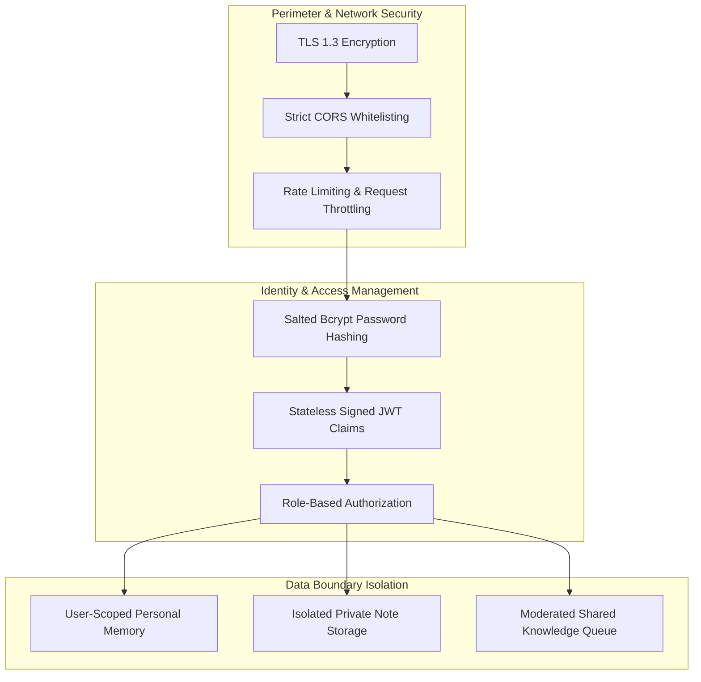

# Security, Privacy & Data Governance Specification
**Project:** AI Learning Companion  
**Compliance Standards:** Privacy by Design, UN SDG 4 Ethical Guidelines, DPDP Act Alignment

---

## 1. Security Architecture & Threat Model

The AI Learning Companion is engineered with a multi-layered defense-in-depth approach to ensure that educational materials, student performance metrics, and personal memories remain secure and private.

---

## 2. Authentication & Credential Management

- **Password Hashing:** Passwords are never stored in plaintext. Passwords are hashed using cryptographic `bcrypt` with automatically generated salts and a work factor of 12.
- **Token Authorization:**
  - Authenticated sessions issue JSON Web Tokens (JWT) signed with HMAC-SHA256.
  - Claims encode the user's subject identifier (`sub`), expiration timestamp (`exp`), and authorization role (`role`).
  - Tokens expire after 24 hours (`ACCESS_TOKEN_EXPIRE_MINUTES = 1440`).
- **Secret Key Rotation:** Supported via externalized `SECRET_KEY` environment variables.

---

## 3. Data Privacy & Learner Memory Isolation

### 3.1 Strict Personal Memory Scoping
The platform records inferred learning traits (such as conceptual strengths, struggling topics, and learning pace) to personalize responses.
- **Strict Isolation:** Every record in `personal_memories` is tied to the learner's `user_id`. Queries strictly enforce `WHERE user_id = current_user.id`.
- **No Shared Model Fine-Tuning:** User private notes and personal memories are never transmitted to shared training pools.
- **User Agency & Purge Controls:** Learners have unrestricted access to inspect their personal memories via the **Memory & Preferences** module and can purge individual memory entries or all records at any time.

### 3.2 Private Notes vs. Shared Knowledge
- **Private by Default:** Uploaded PDFs and generated quizzes are private to the owning user.
- **Opt-in Shared Knowledge:** Learners who wish to contribute notes to the collective knowledge base must explicitly publish them through the Shared Knowledge submission flow.
- **Moderation Queue:** Contributed resources enter a `PENDING_REVIEW` queue where peer ratings and administrative moderation prevent harmful, misleading, or copyrighted content from entering the verified corpus.

---

## 4. Input Sanitization & Document Security

- **File Type & Extension Verification:** Uploads are restricted to `application/pdf` with strict magic-byte verification.
- **Size Limits:** Enforces a maximum upload cap of 25 MB (`MAX_UPLOAD_SIZE_BYTES = 26214400`) to prevent denial-of-service attempts.
- **Scanned Document Detection:** The PDF extraction pipeline checks for low character counts per page. If a document consists of scanned images without text, it notifies the user and rejects silent hallucinations.
- **Prompt Injection Defense:** RAG context formatting explicitly wraps untrusted document contents in delimited text boundaries, instructing the LLM to process input strictly as reference data rather than executable instructions.

---

## 5. Age-Appropriate Content Safeguards

Given that the platform serves younger school learners in addition to university students:
- Explanations for young learners are guided to remain constructive, polite, and free of inappropriate adult references.
- Complex or sensitive topics are handled with educational neutrality and scientific accuracy.
